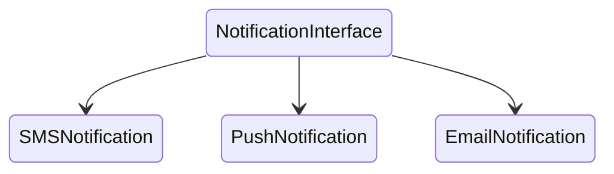

## 🏭 The Factory Pattern: Create with Style!

### *🍰 Why Factory?*

*Imagine you’re baking a cake, and you need different types of cakes for different occasions—chocolate for birthdays,
vanilla for anniversaries, and red velvet for Valentine’s Day.🎂<br/>
Now, do you want to bake each one from scratch every time? No way! That’s where the Factory Pattern comes in.*

*Instead of creating objects directly, you delegate the responsibility to a factory. This way, you can streamline the
process and keep your code clean and maintainable. 🧹*

### 🦄 The Factory Superpower

The Factory Pattern allows you to define an interface or abstract class for creating objects, letting subclasses decide
which class to instantiate. Here’s what makes it fabulous:

	•	Decoupled Creation: Your code doesn’t need to know the specifics of how an object is created. Just call the factory and let it handle the details! This promotes flexibility and reduces tight coupling. 🎈
	•	Enhanced Readability: Using a factory makes your code more readable and easier to maintain. When you see a factory call, you know something cool is happening behind the scenes! 👀
	•	Variability: Need to swap out one object for another? No problem! Just change the factory’s logic, and you’re all set—no need to hunt down every instance of the object in your code. 🔄

#### 💻 Example:

*Here is an illustration of factory pattern.*<br/>

Consider we have to publish Notification and we have different notification channels, i.e SMS, Push, Email etc.<br>
And we want to decide which channel needs to be used everytime we publish, with minimal information provided.<br>
And we have below setup of a Notification Interface with multiple implementation.



The original Spring example uses a notification registry to select a bean from a type. That's a useful **Simple Factory** approach, but it is not the GoF Factory Method pattern: a single creator chooses the implementation instead of subclasses overriding a creation method.

### ☕ The GoF Factory Method

In the Factory Method version, the base creator defines the workflow and leaves product creation to specialized creators. Each creator decides which notification product to return:

```java
NotificationCreator creator = new EmailNotificationCreator();
creator.sendNotification("Your order has shipped");
```

- Creator: [NotificationCreator.java](/dp-factory/src/main/java/com/absolute/bonkers/factory/NotificationCreator.java)
- Concrete creators: [EmailNotificationCreator.java](/dp-factory/src/main/java/com/absolute/bonkers/factory/EmailNotificationCreator.java), [SmsNotificationCreator.java](/dp-factory/src/main/java/com/absolute/bonkers/factory/SmsNotificationCreator.java), and [PushNotificationCreator.java](/dp-factory/src/main/java/com/absolute/bonkers/factory/PushNotificationCreator.java)
- Products: [Notification.java](/dp-factory/src/main/java/com/absolute/bonkers/factory/Notification.java) and its email, SMS, and push implementations

The original Spring registry example remains available as a separate practical variation:
[NotificationFactory.java](/dp-factory/src/main/java/com/absolute/bonkers/factory/NotificationFactory.java).
The focused Factory Method tests are in [NotificationCreatorTest.java](/dp-factory/src/test/java/com/absolute/bonkers/factory/NotificationCreatorTest.java).

Interface:
*[Notification (interface)](/dp-factory/src/main/java/com/absolute/bonkers/factory/Notification.java)*<br>
Factory Implementation Class:
*[NotificationFactory.java](/dp-factory/src/main/java/com/absolute/bonkers/factory/NotificationFactory.java)*<br/>
Test Class:
*[NotificationServiceTest.java](/dp-factory/src/test/java/com/absolute/bonkers/factory/NotificationServiceTest.java)*<br/>

### 🌈 Summary

*In the realm of software design, the Factory Pattern is your best friend for creating objects efficiently and
elegantly.<br/>
By outsourcing the creation process, you can focus on the big picture while ensuring that your code remains clean and
adaptable.<br/>
So, whether you’re crafting game elements, creating UI components, or managing different product types, remember the
Factory Pattern to keep your object creation game strong! 🏆✨*